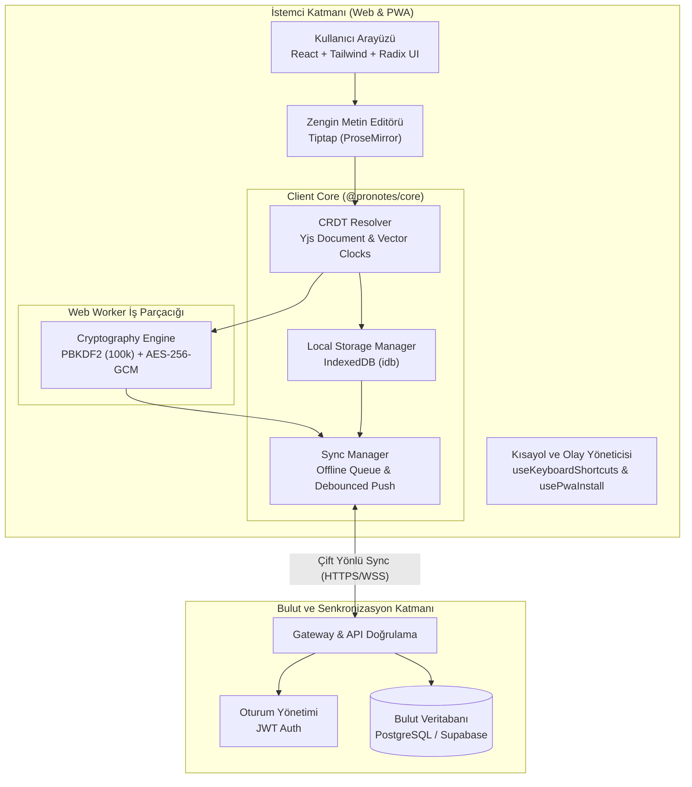

# Sistem Mimarisi ve Tasarımı (System Design v1.1)

**Mimari Vizyon:** Çevrimdışı öncelikli (Offline-First), istemci tarafında şifreleme yapan (Zero-Knowledge E2EE), CRDT tabanlı senkronizasyon kullanan ve PWA standartlarında çalışan ölçeklenebilir not alma altyapısı.

## 1. Sistem Bileşenleri (System Components)

### 1.1 Client Core (Paylaşılan UI-Agnostik Katman)
* **Local Storage Manager (`@pronotes/core/storage`):** İstemci tarafındaki kalıcı depolamayı (IndexedDB) yönetir. "Offline-First" mimarisi gereği tüm okuma ve yazma işlemleri öncelikle yerel veritabanına yapılır.
* **Cryptography Engine (Web Worker):** Ana UI iş parçacığını (Main Thread) kilitlememek için Web Worker içinde çalışır. PBKDF2 (100.000 iterasyon, SHA-256) ile kullanıcının Master Password'ünden 256-bit AES anahtarı türetir ve not içeriklerini AES-256-GCM ile şifreler/çözer.
* **CRDT Resolver (`@pronotes/core/crdt`):** Yjs doküman yapısı ile metin çakışmalarını satır ve karakter bazında matematiksel olarak çözer. İki farklı cihaz aynı anda çevrimdışı not düzenlese bile birleşme sırasında sıfır veri kaybı garantisi sunar.
* **Sync Manager (`@pronotes/core/sync`):** Ağ durumunu (`online` / `offline`) dinler, yerel değişiklikleri debounce (2 sn) ile kuyruğa alır ve ağ geldiğinde tek paket halinde bulut katmanına iletir.

### 1.2 Client UI (Sunum Katmanı)
* **React 18+ SPA & PWA:** Minimalist Google Keep esintili kart ızgarası (Masonry grid), pastel renk sistemi ve karanlık mod desteği.
* **Tiptap Markdown Editörü:** Sözdizimi tabanlı zengin metin desteği (kalın, italik, madde listesi, kod bloğu).
* **Güvenli NoteModal:** Kapatma eylemi tek başına izole edilmiş, silme eylemi modalın altına taşınmış ve iki aşamalı onay diyaloğu ile korunmuştur.
* **PWA & Service Worker:** `vite-plugin-pwa` ile çevrimdışı asset önbelleği, `beforeinstallprompt` ile tarayıcı içi kurulum ve Google Fonts için runtime CacheFirst stratejisi.

### 1.3 Backend ve Senkronizasyon Katmanı
* **Dumb Relay Prensibi:** Sunucu katmanı Kasa notlarının şifreleme anahtarlarına asla sahip değildir. Sunucu yalnızca şifrelenmiş byte dizilerini (ciphertext blob) saklar ve cihazlar arasında iletir.
* **Standart Not Senkronizasyonu:** Şifresiz standart notlar için hızlı full-text search ve bulut yedekleme.

---

## 2. Detaylı Veri Akışları (Data Flow)

### 2.1 Standart Not Senkronizasyonu (Çevrimdışı -> Çevrimiçi)
1. Kullanıcı internet bağlantısı yokken yeni bir not yazar veya mevcut notu düzenler.
2. **Client Core:** İçeriği Yjs CRDT güncellemesine dönüştürür ve doğrudan IndexedDB'ye yazar. Arayüzde anında güncellenir.
3. Kullanıcı internete bağlandığında `networkStore` tetiklenir ve arayüzde geçici yeşil "Bağlantı Sağlandı" bildirimi gösterilir.
4. **Sync Manager:** Bekleyen CRDT güncellemelerini paketler ve bulut gateway'ine gönderir.

### 2.2 Sıfır Bilgi Şifreli Kasa (Zero-Knowledge Vault) Akışı
1. Kullanıcı Master Password girer.
2. Web Worker içinde PBKDF2 ile anahtar türetilir. Türetilen anahtar bellekte (RAM) tutulur, asla `localStorage`'a yazılmaz.
3. Kullanıcı Kasa notunu kaydettiğinde, Web Worker içeriği ve CRDT operasyonunu AES-256-GCM ile şifreler (rastgele 12-byte IV ile).
4. İstemci yalnızca şifrelenmiş byte dizisini ve IV değerini IndexedDB ve sunucuya gönderir.
5. Canlı E2E tarayıcı testlerinde doğrulanmıştır: Kasa notunun içeriği (`GIZLIKELIME123`) hiçbir ağ paketinde veya yerel depolama kaydında açık metin olarak yer almaz.

### 2.3 Salt Okunur Link Paylaşımı (#share/...)
1. Kullanıcı not detayında "Salt Okunur Link Oluştur" butonuna basar.
2. Not başlığı, içeriği ve rengi JSON olarak paketlenip base64/URL-safe formata dönüştürülür.
3. Link `#share/{payload}` hash formatında üretilir. Hash fragment sunucuya iletilmez (istemcide kalır).
4. Paylaşılan linki açan kullanıcı, salt okunur Tiptap görünümüyle notu görüntüler.

---

## 3. Teknik Kısıtlar ve Mimari Sınırlar

* **Sunucu Tarafında Arama Yapılamaz:** Kasa notları E2EE ile şifrelendiği için metin araması yalnızca kullanıcının cihazında, Kasa kilidi açıldıktan sonra yerel bellek indekslemesi ile yapılır.
* **Şifre Kurtarma İmkânsızlığı:** Master Password sunucuya gitmediği için sıfırlama mekanizması yoktur. Şifre unutulursa Kasa verileri matematiksel olarak kurtarılamaz.
* **Payload Büyüklüğü ve GC:** CRDT operasyon geçmişi büyüdükçe periyodik Garbage Collection ile Yjs dokümanı sıkıştırılır (snapshot compacting).
* **Performans Bütçesi:** Web Worker kullanımı sayesinde PBKDF2 iterasyonları ve AES işlemleri sırasında 60 FPS arayüz akıcılığı korunur; ilk açılış PWA önbelleği ile 500 ms altındadır.