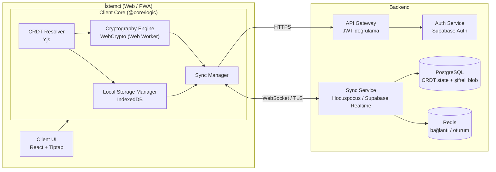

# Not Uygulaması – Ürün ve Mühendislik Dokümantasyonu

> **Sürüm:** v1.1 (PWA & Enhanced Note Experience)
> **Kaynak dokümanlar:** `requirements.md`, `mvp_scope.md`, `system_design.md`, `tech_stack.md`, `acceptance_criteria.md`
> **Amaç:** Ürün vizyonu, mimari, teknoloji seçimleri, kabul kriterleri, v1.1 özellikleri ve teknik kararları tek bir güvenilir referans noktasında toplamak.

---

## İçindekiler

1. [Ürün Özeti](#1-ürün-özeti)
2. [Hedef Kullanıcılar](#2-hedef-kullanıcılar)
3. [MVP Kapsamı (MoSCoW)](#3-mvp-kapsamı-moscow)
4. [Fonksiyonel Gereksinimler ve Gerçekleşme Durumu](#4-fonksiyonel-gereksinimler-ve-gerçekleşme-durumu)
5. [Fonksiyonel Olmayan Gereksinimler](#5-fonksiyonel-olmayan-gereksinimler)
6. [Sistem Mimarisi](#6-sistem-mimarisi)
7. [Teknoloji Yığını](#7-teknoloji-yığını)
8. [Güvenlik Modeli (E2EE Kasa)](#8-güvenlik-modeli-e2ee-kasa)
9. [Kabul Kriterleri ve Test Doğrulama Durumu](#9-kabul-kriterleri-ve-test-doğrulama-durumu)
10. [Başarı Metrikleri](#10-başarı-metrikleri)
11. [UI/UX İlkeleri ve Güvenli Etkileşim](#11-uiux-ilkeleri-ve-güvenli-etkileşim)
12. [Yol Haritası](#12-yol-haritası)
13. [Çözümlenen Teknik Kararlar ve v2.0 Vizyonu](#13-çözümlenen-teknik-kararlar-ve-v20-vizyonu)
14. [Sözlük](#14-sözlük)

---

## 1. Ürün Özeti

### 1.1 Uzun Vadeli Vizyon
Günlük kullanıcılar için Google Keep sadeliğinde başlayan; "Power User" ve ekipler için zengin metin düzenleme (Markdown), Uçtan Uca Şifreli (E2EE) Kasa, CRDT tabanlı çevrimdışı çalışma ve gerçek zamanlı senkronizasyon sunan modern bir üretkenlik platformu.

### 1.2 Ürün Hedefi (v1.1)
> **"Sade Arayüz, Güçlü Markdown ve Uçtan Uca Şifreli Gizli Kasa"** sunan; bireysel odaklı, çevrimdışı tam yetenekli (Offline-First PWA), masaüstü ve mobil ana ekrana kurulabilir, modern web tabanlı not uygulaması.

### 1.3 Mimari Vizyon
Çevrimdışı öncelikli (Offline-First), istemci tarafında şifreleme yapan (Zero-Knowledge), CRDT tabanlı senkronizasyon kullanan (Yjs), Web Worker tabanlı kripto motoruna sahip ölçeklenebilir not alma altyapısı.

---

## 2. Hedef Kullanıcılar

| Persona | Profil | İhtiyaç | Gerçekleşme Durumu |
|---|---|---|---|
| **Günlük Kullanıcı** ("Sadelik Arayan") | Öğrenci, standart ofis çalışanı | Fikir, alışveriş listesi ve yapılacakları sıfır gecikmeyle kaydetmek; Google Keep sadeliği | ✅ v1.0/v1.1 Tamamlandı |
| **Power User / Geliştirici** ("Güvenlik ve Fonksiyon Arayan") | Yazılım mühendisi, veri uzmanı, araştırmacı | Kod blokları, API anahtarı/token saklamak için yüksek güvenlik (E2EE Kasa), Markdown dışa aktarma, klavye kısayolları | ✅ v1.0/v1.1 Tamamlandı |
| **Kurumsal Ekip / Proje Yöneticisi** ("İşbirliği Arayan") | Startup kurucusu, takım yöneticisi | Eşzamanlı canlı imleçler, takım içi rol yönetimi | ❌ v2.0+ (Kapsam dışı) |

---

## 3. MVP Kapsamı (MoSCoW)

### 3.1 Must-Have (v1.0 - ✅ TAMAMLANDI)

| Özellik | Açıklama |
|---|---|
| **Minimalist UI** | Google Keep benzeri masonry grid / kart görünümü |
| **Temel Notlar** | Yerel veritabanında saklanan, anında aranabilir ve bulutla eşitlenen metin notları |
| **Şifreli Kasa (E2EE)** | Kullanıcının belirlediği Master Password ile açılan; verilerin tarayıcıda AES-256-GCM ile şifrelenip sunucuya anlamsız blob olarak gittiği sıfır bilgi alanı |
| **Temel Markdown** | `/` menüsü olmadan; kalın, italik, liste ve syntax-highlighted kod blokları |
| **Çevrimdışı Temel Destek** | İnternet yokken not alma; online olunca Yjs (CRDT) ile çakışmasız senkronizasyon |
| **Platform** | Responsive Web App ve PWA desteği |

### 3.2 Should-Have (v1.1 – ✅ TAMAMLANDI)
- **PWA Kurulum Deneyimi:** `beforeinstallprompt` hook'u, kenar çubuğunda "Uygulamayı Yükle" butonu, Google Fonts runtime caching ve eksiksiz çevrimdışı cache.
- **Notları Salt Okunur Link ile Paylaşma:** `#share/...` hash mekanizması ve readonly Tiptap render.
- **Markdown Dışa Aktarma:** `.md` formatında indirme ve tek tıkla panoya kopyalama.
- **Not Renklendirme ve Etiketleme (Tagging):** 6'lı pastel renk seçimi, etiket yönetimi ve sidebar üzerinden etiket filtreleme.
- **Karanlık Mod (Dark Mode):** Kolay tema geçiş butonu ve göz yormayan karanlık palet.
- **Klavye Kısayolları:** `N`, `/`, `?`, `Ctrl+K`, `Esc` tuşları ve girdi alanlarında kısayolların engellenmesi koruması.
- **Güvenli NoteModal:** İzole Kapat ($X$) butonu, alt barda iki aşamalı onaylı Silme butonu, ilk açılışta doğrudan başlığa odaklanma ve minimum 44x44 px dokunma alanları.
- **Çevrimdışı Bildirim Çubuğu:** Ağ koptuğunda üstte sarı uyarı, bağlantı geldiğinde yeşil bildirim.

### 3.3 Could-Have (v2.0)
- Mobil native uygulamalar (iOS / Android)
- Yüz tanıma / parmak izi ile Kasa açılışı (WebAuthn)
- Markdown tabloları ve gelişmiş bağlantılı not (Backlinking) yapısı

### 3.4 Won't-Have (şu an kapsam dışı)
- Aynı not üzerinde eşzamanlı ortak çalışma (Multiplayer / canlı imleçler)
- Not içi blok yorumları ve `@` ile etiketleme
- Kurumsal paketler, ekip çalışma alanları, yetki yönetimi (Admin Panel)

---

## 4. Fonksiyonel Gereksinimler ve Gerçekleşme Durumu

| ID | Gereksinim | Durum |
|---|---|---|
| **FR-1** | Açılış ekranı minimalist kart/post-it ızgarası (grid) olmalı | ✅ Tamamlandı |
| **FR-2** | Sözdizimi tabanlı Markdown editörü (kalın, italik, liste, kod bloğu) | ✅ Tamamlandı |
| **FR-3** | Standart notlar: yerelde anında arama, sunucuda şifreli senkronizasyon | ✅ Tamamlandı |
| **FR-4** | Master Password ile açılan Şifreli Kasa | ✅ Tamamlandı |
| **FR-5** | Kasa notları cihazda uçtan uca şifrelenmeli (Zero-Knowledge AES-256-GCM) | ✅ Tamamlandı (E2E doğruluğu kanıtlandı) |
| **FR-6** | İnternetsiz yeni not oluşturma / düzenleme (Offline-first IndexedDB) | ✅ Tamamlandı |
| **FR-7** | Çevrimdışı/çevrimiçi çakışmaları CRDT (Yjs) ile otomatik birleştirme | ✅ Tamamlandı |
| **FR-8** | Standart notları salt okunur link (#share) ve Markdown (.md) olarak dışa aktarma | ✅ Tamamlandı (v1.1) |
| **FR-9** | PWA masaüstü/mobil kurulabilirlik ve Service Worker çevrimdışı cache | ✅ Tamamlandı (v1.1) |
| **FR-10** | Klavye kısayolları (`N`, `/`, `?`, `Ctrl+K`) ve güvenli modal tasarımı | ✅ Tamamlandı (v1.1) |

`requirements.md` tam ürün vizyonunu tanımlar. Aşağıdaki tablo her gereksinimin MVP'deki karşılığını gösterir.

| ID | Gereksinim | MVP Durumu |
|---|---|---|
| **FR-1** | Açılış ekranı minimalist kart/post-it ızgarası (grid) olmalı | ✅ Kapsamda |
| **FR-2** | `/` tuşu veya Markdown sözdizimi ile zengin metin editörü aktif olmalı (kod bloğu, tablo, başlık hiyerarşisi) | ⚠️ Kısmen. Yalnızca sözdizimi tabanlı Markdown (kalın, italik, liste, kod bloğu). **Slash menüsü ve tablolar yok** |
| **FR-3** | Standart notlar: sunucuda şifreli, aranabilir, şifre sıfırlamaya uygun | ✅ Kapsamda (bkz. [Açık Soru #2](#13-dokümanlar-arası-tutarsızlıklar-ve-açık-sorular)) |
| **FR-4** | Master Password veya biyometrik (FaceID/Parmak İzi) ile açılan Şifreli Kasa | ⚠️ Kısmen. Yalnızca Master Password. Biyometrik v2.0 |
| **FR-5** | Kasa notları cihazda uçtan uca şifrelenmeli (Zero-Knowledge), sunucuya yalnızca şifreli blok gitmeli; sunucuda aranamaz ve paylaşılamaz | ✅ Kapsamda |
| **FR-6** | İnternetsiz yeni not oluşturma / düzenleme (Offline-first) | ✅ Kapsamda |
| **FR-7** | Çevrimdışı/çevrimiçi çakışmaları CRDT ile satır ve karakter bazında otomatik birleştirme (sıfır veri kaybı) | ✅ Kapsamda (tek kullanıcının birden fazla cihazı için) |
| **FR-8** | Standart notları e-posta daveti veya link ile paylaşma | ⚠️ Yalnızca salt okunur link, v1.1'de. E-posta daveti kapsam dışı |
| **FR-9** | Canlı imleç ve eşzamanlı düzenleme (Multiplayer) | ❌ Won't-Have |
| **FR-10** | Blok yorumları ve `@` ile kullanıcı etiketleme | ❌ Won't-Have |
| **FR-11** | Freemium model | ❌ MVP kapsamında listelenmemiş |
| **FR-12** | "Pro" ve "Team" abonelik katmanları, ödeme geçidi | ❌ MVP kapsamında listelenmemiş |
| **FR-13** | Merkezi faturalandırma (admin panel), rol tabanlı yetkilendirme | ❌ Won't-Have |

---

## 5. Fonksiyonel Olmayan Gereksinimler ve MVP Durumu

| ID | Gereksinim | MVP Durumu |
|---|---|---|
| **NFR-1** | İlk açılış (Time to Interactive) < **1.5 sn** | ✅ Kapsamda (yalnızca web/PWA) |
| **NFR-2** | Ortak çalışmada tuş vuruşu en fazla **50 ms** gecikmeyle diğer kullanıcıya yansımalı | ❌ Multiplayer kapsam dışı. MVP'de cihazlar arası hedef: **≤ 3 sn** |
| **NFR-3** | Yatay ölçeklenebilir (auto-scaling) sunucu mimarisi | ⚠️ Yönetilen servislerle (Supabase vb.) karşılanması beklenir; MVP için açık bir kabul kriteri yok |
| **NFR-4** | Standart notlar: uçuşta TLS 1.3, sunucuda AES-256 | ✅ Kapsamda |
| **NFR-5** | Kasa: istemci tarafında AES-256-GCM, anahtarlar asla sunucuya iletilmez | ✅ Kapsamda |
| **NFR-6** | GDPR ve SOC-2 uyumluluğuna baştan hazır tasarım | ⚠️ MVP'de açık bir iş kalemi yok, sonraya kalmaması için takip edilmeli |
| **NFR-7** | Onboarding: kayıttan ilk nota **en fazla 3 tıklama / 15 sn** | ⚠️ Kabul kriterlerinde yer almıyor, eklenmesi önerilir |
| **NFR-8** | Web, iOS, Android'de %100 tutarlı deneyim | ❌ MVP yalnızca PWA. Native uygulamalar v2.0 |

---

## 6. Sistem Mimarisi

### 6.1 Bileşenler

**Client Core (paylaşılan kütüphane, UI'dan bağımsız)**
- **Local Storage Manager:** İstemci tarafı verileri (IndexedDB; mobilde SQLite) yönetir. **Tüm okuma/yazma önce buraya** yapılır.
- **Cryptography Engine:** AES-256-GCM şifreleme/deşifreleme; Master Password'den anahtar türetme.
- **CRDT Resolver (Yjs):** Yerel ve uzak veriler arasındaki metin çakışmalarını matematiksel olarak birleştirir.
- **Sync Manager:** Çevrimiçi/çevrimdışı durumu dinler, güncellemeleri kuyruğa alır, backend ile haberleşir.

**Client UI (Presentation)**
- Web/PWA arayüzü. Yalnızca Core'un sunduğu arayüzleri tüketir, **iş mantığı içermez**.

**Backend Servisleri (Microservices / Modüler Monolit)**
- **API Gateway:** İstekleri karşılar, JWT doğrular, ilgili servise yönlendirir.
- **Auth Service:** Kayıt, giriş, token üretimi.
- **Sync Service (WebSocket):** İstemciler arası CRDT güncellemelerini alır, doğrular, veritabanına yazar.

**Veri Katmanı**
- **Primary DB:** CRDT metadatası ve şifreli not blob'ları (esnek doküman yapısı).
- **Cache (Redis):** Aktif WebSocket bağlantı durumu ve oturum bilgileri.

### 6.2 Mimari Diyagram



### 6.3 Veri Akışları

**A) Standart Not Senkronizasyonu (Çevrimdışı → Çevrimiçi)**
1. Kullanıcı internet yokken not yazar.
2. Client Core değişikliği Yjs (CRDT) formatına çevirir ve yerel veritabanına kaydeder.
3. Kullanıcı internete bağlanır.
4. Sync Manager bekleyen CRDT güncellemelerini paketler ve Sync Service'e (WebSocket) gönderir.
5. Sync Service gelen operasyonları Primary DB'deki not geçmişinin üzerine "yeni operasyonlar" olarak yazar ve varsa diğer aktif cihazlara anında push eder.

**B) Şifreli Kasa Yazma**
1. Kullanıcı Master Password girer.
2. Cryptography Engine, şifreden KDF ile **bellekte tutulan** bir anahtar üretir.
3. Kullanıcı notu düzenler; CRDT Resolver değişiklikleri operasyon vektörüne çevirir.
4. Cryptography Engine CRDT vektörünü **AES-256-GCM ile tamamen şifreler**.
5. Sync Manager şifreli blob'u sunucuya gönderir. Sunucu veriyi okuyamaz, yalnızca saklar ve diğer cihazlara aktarır.

### 6.4 Teknik Kısıtlar

| Kısıt | Sonuç |
|---|---|
| **Sunucu tarafında arama yapılamaz (Kasa)** | Kasa aramaları yalnızca cihazda, şifre çözüldükten sonra yerel indeksleme ile yapılır |
| **Şifre kurtarma imkânsız** | Master Password sunucuya gitmediği için sıfırlama yoktur. Unutulursa Kasa verisi kriptografik olarak kurtarılamaz |
| **Payload şişmesi** | CRDT, metnin kendisinden çok ekleme/silme geçmişini tuttuğu için boyut zamanla büyür. İstemci ve sunucuda periyodik Garbage Collection / geçmiş sıkıştırma şarttır |
| **Performans bütçesi** | 1.5 sn hedefi için şifreleme ve CRDT işlemleri **Web Worker**'larda asenkron çalışmalı, Main Thread bloklanmamalı |

---

## 7. Teknoloji Yığını

### 7.1 Ana Teknolojiler
| Alan | Seçim |
|---|---|
| Dil | **TypeScript (Strict Mode)** |
| Monorepo | **Turborepo**, paketler: `core`, `ui`, `web` (Clean Architecture) |

### 7.2 Frontend
| Alan | Seçim | Gerekçe |
|---|---|---|
| Framework | **React 18+ (Vite, SPA/PWA)** | Next.js SSR'ı offline-first bir E2EE uygulama için gereksiz karmaşıklık; Vite hızlı PWA için ideal |
| State | **Zustand** | Redux'tan hafif, az boilerplate, Yjs state'ini UI'a bağlamak kolay |
| Stil | **Tailwind CSS + Radix UI** | Erişilebilir (a11y) hazır bileşenleri hızla minimalist arayüze dönüştürmek |
| Editör | **Tiptap (ProseMirror)** | Modüler yapı, temel Markdown için yeterli; Yjs ile yerleşik CRDT desteği |

### 7.3 Client Core (`@core/logic`)
| Alan | Seçim | Not |
|---|---|---|
| CRDT | **Yjs** | Vektör saatleriyle metin çakışma çözümü |
| Yerel DB | **IndexedDB** (`idb` veya `y-indexeddb`) | Yjs dokümanlarını cihazda kalıcı saklamak için |
| Kriptografi | **WebCrypto API** | **PBKDF2** (anahtar türetme) + **AES-256-GCM** (şifreleme). **Mutlaka Web Worker içinde** |

### 7.4 Backend ve Veri
| Alan | Seçim | Not |
|---|---|---|
| BaaS | **Supabase** | |
| Kimlik doğrulama | **Supabase Auth** (JWT) | |
| Veritabanı | **PostgreSQL** | CRDT state'leri `BYTEA` veya Base64 `JSONB` kolonlarında şifreli blob olarak |
| Sync | **Hocuspocus** (Node.js WS) **veya Supabase Realtime** | Sunucu "aptal röle" (dumb relay) olmalı, Kasa içeriğini asla parse edememeli |

### 7.5 Altyapı ve CI/CD
- **Frontend hosting:** Vercel veya Cloudflare Pages (global edge cache)
- **Backend hosting:** Supabase Cloud + (gerekirse Hocuspocus için) Render/Railway
- **CI/CD:** GitHub Actions (tip kontrolü, lint, otomatik deploy)

---

## 8. Güvenlik Modeli (E2EE Kasa)

| Konu | Kural |
|---|---|
| **Algoritmalar** | PBKDF2 (anahtar türetme) + AES-256-GCM (şifreleme) |
| **Master Password** | İlk girişte en az **8 karakter** |
| **Anahtar yönetimi** | Türetilen anahtarlar `localStorage`'a düz metin yazılamaz. Oturum kapanınca bellekten silinir |
| **Sunucuya giden veri** | Yalnızca anlamsız byte dizileri (blob). Network sekmesinde düz metin görünmemeli |
| **Parola doğrulama** | Yanlış parola, sunucuya sormadan, yerel kriptografik **MAC hatası** yakalanarak "Şifre Yanlış" uyarısıyla bildirilir |
| **Şifremi Unuttum** | **Olmamalı.** Verilerin kurtarılamayacağı UI'da net biçimde belirtilmeli |
| **İş parçacığı** | Tüm kripto işlemleri Web Worker'da. Yazma sırasında takılma olmamalı |
| **Erişim** | Ana şifre girilmeden Kasa sekmesine erişilemez. API şifreli veriyi dönse bile deşifre edilemediği için gösterilemez |
| **Paylaşım / Arama** | Kasa notları sunucuda aranamaz ve paylaşılamaz |
| **Standart notlar** | TLS 1.3 ile iletim, sunucuda AES-256 ile dinlenme halinde şifreleme |

---

## 9. Kabul Kriterleri ve Test Kontrol Listesi

> Aşağıdaki maddeler `acceptance_criteria.md`'nin özetidir. Bir özellik, ilgili tüm maddeler sağlandığında "Bitti" (Definition of Done) sayılır. QA süreçleri bu listeye göre yürütülür.

### 9.1 Temel Not Senkronizasyonu
**Fonksiyonel**
- [ ] "Yeni Not" tıklanınca boş bir not kartı anında oluşur ve odaklanır
- [ ] İçerik değişince en geç **2 sn** içinde sunucuya (Supabase) otomatik kaydedilir
- [ ] Silinen not UI'dan anında kalkar (optimistic update), sunucuda arka planda silinir

**Tutarlılık**
- [ ] Bir cihazda eklenen/güncellenen/silinen not, aynı hesabın diğer açık cihazında en geç **3 sn** içinde görünür

**Performans ve UI**
- [ ] Ana ekran **< 1.5 sn** yüklenir (NFR-1)
- [ ] Google Keep tarzı masonry grid; kartlar ekran boyutuna göre dinamik dizilir

**Uç durumlar**
- [ ] Tek seferde **50.000 karakter** yapıştırılınca UI thread bloklanmaz, kayıt asenkron yapılır
- [ ] Ağ tamamen koptuğunda kullanıcı uyarı görmeden yazmaya devam eder

### 9.2 Şifreli Kasa (E2EE)
**Fonksiyonel**
- [ ] İlk girişte en az 8 karakterlik Master Password belirlenebilir
- [ ] Ana şifre girilmeden Kasa'ya erişilemez
- [ ] Kasa notları sunucuya düz metin değil, **AES-256-GCM** ile şifrelenmiş blob olarak gider (Network sekmesinde doğrulanır)

**Tutarlılık**
- [ ] 1. cihazda yazılan şifreli not, Kasası açık olan 2. cihazda anında deşifre edilip gösterilir

**Güvenlik ve performans**
- [ ] PBKDF2 ve AES-256-GCM işlemleri Web Worker'da, yazarken takılma yok
- [ ] Türetilmiş anahtarlar `localStorage`'a düz metin yazılmaz, oturum kapanınca bellekten silinir

**Uç durumlar**
- [ ] Yanlış parolada "Şifre Yanlış" uyarısı, sunucu doğrulaması beklenmeden (yerel MAC hatası ile)
- [ ] "Şifremi Unuttum" seçeneği yok; verilerin kurtarılamayacağı UI'da belirtilir

### 9.3 Çevrimdışı Çalışma ve CRDT
**Fonksiyonel**
- [ ] Offline modda not oluşturma ve düzenleme başarılı, veriler IndexedDB'ye kaydedilir
- [ ] Bağlantı gelince Sync Manager bekleyen Yjs güncellemelerini **tek paket** halinde iletir

**Tutarlılık**
- [ ] Aynı not iki cihazda da offline düzenlenirse, ikisi de online olunca CRDT iki değişikliği otomatik birleştirir, **veri kaybı olmaz**

**Performans ve limitler**
- [ ] IndexedDB kotası dolmaya yaklaşınca eski CRDT geçmişi Garbage Collection ile sıkıştırılır

**Uç durumlar**
- [ ] Bağlantı gidip gelirken (flaky network) WebSocket kopup yeniden bağlandığında **çift (duplicate) veri yazılmaz**, sync state sorunsuz devam eder

### 9.4 Temel Markdown Editörü
**Fonksiyonel**
- [ ] Metin seçip kısayol (Cmd+B vb.) kullanınca metin kalın olur
- [ ] Satır başında `* ` yazınca madde işaretli listeye dönüşür
- [ ] Üç ters tırnak (` ``` `) yazınca kod bloğuna dönüşür

**Tutarlılık**
- [ ] Web'de oluşturulan içerik (Tiptap JSON formatında Yjs verisi) mobil görünümde (PWA / responsive) görsel olarak **birebir** aynı render edilir

**UX**
- [ ] Slash (`/`) komut menüsü MVP'de **gösterilmez**; yalnızca sözdizimi tabanlı biçimlendirme

**Uç durumlar**
- [ ] Başka siteden yapıştırılan karmaşık HTML'de desteklenmeyen etiketler (resim, tablo) temizlenir; yalnızca düz metin ve temel Markdown korunur

---

## 10. Başarı Metrikleri

### 10.1 MVP Metrikleri
| Metrik | Tanım | Hedef |
|---|---|---|
| **Aktivasyon** | Kayıt olanların ilk 24 saatte en az 1 not oluşturma oranı | **> %60** |
| **Kasa Kullanımı (Core Value)** | Aktif kullanıcıların ilk şifreli notunu oluşturma oranı | **≥ %20** (olmazsa rekabet avantajı yok demektir) |
| **Bağlılık** | Day-7 geri dönüş oranı | **> %25** |
| **Performans** | İlk yüklenme ve etkileşime hazır olma süresi | **< 1.5 sn** |

### 10.2 Uzun Vadeli Metrikler (vizyon)
| Kategori | Metrik | Hedef |
|---|---|---|
| Gelir | Free-to-Paid dönüşüm oranı | %4–%6 |
| Gelir | MRR (bireysel abonelik) | – |
| Gelir | ARPA (kurumsal) | – |
| Gelir | Net Retention Rate (NRR) | > %100 |
| Etkileşim | DAU / MAU | > %30 |
| Etkileşim | Vault Adoption Rate (≥1 not koyan kullanıcı oranı) | – |
| Etkileşim | Multiplayer Session Count (haftalık) | – |
| Mühendislik | CRDT Conflict Count (otomatik birleştirmenin devreye girdiği başarılı senkronizasyon sayısı) | – |

---

## 11. UI/UX İlkeleri ve Güvenli Etkileşim

- **Kademeli gösterim (Progressive Disclosure):** Açılışta yalın bir kart/post-it ızgarası; zengin özellikler yalnızca gerektiğinde ortaya çıkar.
- **Minimalist grid:** Google Keep tarzı masonry yerleşim, kartlar ekrana göre dinamik dizilir.
- **Yeni not:** Tek tıkla veya klavyeden `N` tuşuna basarak anında boş kart ve başlığa odaklanma.
- **Sözdizimi tabanlı biçimlendirme:** Slash menüsü yok. `* `, ` ``` `, Cmd+B / Ctrl+B gibi kısayol ve Markdown yazımı yeterli.
- **Klavye Kısayolları ve Koruma:** `N`, `/`, `?`, `Ctrl+K`, `Esc` kısayolları mevcuttur; kullanıcı herhangi bir yazı alanındayken veya Tiptap editöründe yazarken kısayollar kesinlikle tetiklenmez.
- **Güvenli NoteModal Etkileşimi:**
  - Kapat ($X$) butonu sağ üstte tek başına yer alır; yanında veya çaprazında kaza riski oluşturacak eylem butonu bulunmaz.
  - Sil ($Trash2$) butonu pencerenin sol alt footer alanına taşınmıştır. Yanlışlıkla basılsa dahi doğrudan silinmez; iki aşamalı onay diyaloğu ("Notu Silmek İstiyor Musunuz?") ile korunur.
  - Paylaş butonu sol üstte not rozetinin yanında yer alır ve tek tip buton varyantı kullanır.
  - Pencere açıldığında odak kapatma/silme butonlarına değil, doğrudan not başlığı girdisine verilir (`autoFocus`).
  - Tüm dokunma hedefleri en az 44x44 px olup erişilebilirlik (WCAG / a11y) standartlarına uygundur.
- **Çevrimdışı deneyim:** Ağ koptuğunda kullanıcı sarı bilgilendirme çubuğu eşliğinde kesintisiz yazmaya devam eder; bağlantı sağlandığında yeşil bildirimle eşitlenir.
- **Kasa arayüzü:**
  - Ana şifre girilmeden Kasa sekmesi açılmaz.
  - Yanlış şifrede sunucuya sorulmadan yerel MAC hatasıyla anında "Şifre Yanlış" mesajı verilir.
  - Şifre belirleme ekranında "unutulursa kurtarılamaz" uyarısı açıkça gösterilir; "Şifremi Unuttum" bağlantısı bulunmaz.
- **Karanlık Mod:** Göz yormayan koyu tema, tek tıkla açık/koyu mod geçişi.
- **Tutarlılık ve PWA:** Masaüstü ve 375 px mobil ekranlarda %100 responsive düzen; tarayıcı menüsünden veya Sidebar'daki "Uygulamayı Yükle" butonuyla ana ekrana tek tıkla kurulabilirlik.

---

## 12. Yol Haritası

| Sürüm | İçerik | Durum |
|---|---|---|
| **v1.0 (MVP)** | Minimalist grid UI, senkronize standart notlar, E2EE Şifreli Kasa, temel Markdown, offline-first + Yjs, Responsive Web | ✅ Tamamlandı & Doğrulandı |
| **v1.1** | PWA Kurulum Deneyimi (`beforeinstallprompt` + Google Fonts runtime cache), Salt okunur link (#share), Markdown export, renk & etiketleme, Karanlık Mod, klavye kısayolları, güvenli NoteModal mimarisi | ✅ Tamamlandı & Doğrulandı |
| **v2.0** | Mobil native uygulamalar (iOS / Android), biyometrik Kasa açılışı (WebAuthn), Markdown tabloları ve bağlantılı notlar (Backlinking) | 📋 Planlandı |
| **Sonrası (Rafta)** | Multiplayer / canlı imleç, yorum ve `@` etiketleme, takım çalışma alanları, admin panel, abonelik ve ödeme | ⏸️ Beklemede |

---

## 13. Çözümlenen Teknik Kararlar ve v2.0 Vizyonu

v1.0 sürecindeki açık mimari sorular v1.1 geliştirmeleri sırasında netleştirilmiş ve üretime alınmıştır:

1. **Standart Notlarda Hızlı Arama:** İstemci tarafında yerel IndexedDB ve Zustand store üzerinden anlık sıfır gecikmeli bellek araması uygulanmıştır. Ağ sızıntısı önlenmiştir.
2. **Kasa için E2EE Kriptografi:** Web Worker üzerinde `crypto.subtle` kullanılarak PBKDF2 (100.000 iterasyon, SHA-256) ve AES-256-GCM (12-byte rastgele IV) uygulanmıştır. Kasa notlarının içeriği asla ağ paketlerinde veya depolamada açık metin olarak yer almaz.
3. **Parola Doğrulama:** Yanlış parola girişleri AES-GCM tag doğrulama hatası (MAC mismatch) ile yerel olarak yakalanır; sunucuya parola veya doğrulayıcı hash gönderilmez.
4. **Salt ve Anahtar Yaşam Döngüsü:** 16-byte rastgele salt şifreli not bloğunun başında saklanır. Türetilen CryptoKey yalnızca bellek (RAM) içinde tutulur, `localStorage`'a yazılmaz ve "Kasayı Kilitle" eylemiyle anında bellekten temizlenir.
5. **Salt Okunur Paylaşım:** Sunucusuz, URL `#share/{base64Payload}` hash mekanizması geliştirilmiştir. URL hash sunucu loglarına gitmez ve istemcide güvenle render edilir.
6. **PWA & Çevrimdışı Önbellek:** `vite-plugin-pwa` ile core asset'ler precache edilir; Google Fonts font dosyaları Workbox CacheFirst stratejisiyle 1 yıl süreli önbelleğe alınır.
7. **NoteModal Güvenlik Mimarisi:** Yanlışlıkla silmeyi önlemek için Silme butonu alt bara alınmış, çift aşamalı onay diyaloğu eklenmiş ve Kapat butonu bağımsız sağ üst köşede konumlandırılmıştır. Odak varsayılan olarak not başlığı girdisine verilir.

---

## 14. Sözlük

| Terim | Açıklama |
|---|---|
| **E2EE** | End-to-End Encryption. Veri yalnızca kullanıcının cihazında çözülebilir |
| **Zero-Knowledge** | Sunucunun kullanıcı verisinin içeriğini ve anahtarlarını bilmediği mimari |
| **CRDT** | Conflict-free Replicated Data Type. Çakışmaların otomatik ve veri kaybı olmadan birleştirildiği veri yapısı |
| **Yjs** | JavaScript için CRDT kütüphanesi |
| **Tiptap / ProseMirror** | Modüler zengin metin editörü altyapısı |
| **Hocuspocus** | Yjs için optimize edilmiş WebSocket sunucusu |
| **Offline-First** | Önce yerel depoya yazan, ağ varsa senkronize eden mimari yaklaşım |
| **PWA** | Progressive Web App. Kurulabilir, çevrimdışı çalışabilen web uygulaması |
| **PBKDF2** | Paroladan kriptografik anahtar türeten fonksiyon (KDF) |
| **AES-256-GCM** | Hem şifreleme hem bütünlük doğrulaması (MAC/authentication tag) sağlayan simetrik şifreleme |
| **Web Worker** | Ana UI iş parçacığından bağımsız arka plan iş parçacığı |
| **Dumb Relay** | Veriyi yorumlamadan yalnızca ileten/saklayan sunucu |
| **Garbage Collection (GC)** | Eski CRDT geçmişinin sıkıştırılıp temizlenmesi |
| **Optimistic UI** | İşlemin sunucu onayı beklenmeden arayüzde anında yansıtılması |
| **MoSCoW** | Must / Should / Could / Won't önceliklendirme yöntemi |
| **PMF** | Product-Market Fit. Ürün-pazar uyumu |
| **RLS** | Row Level Security. Veritabanında satır bazlı erişim kontrolü |