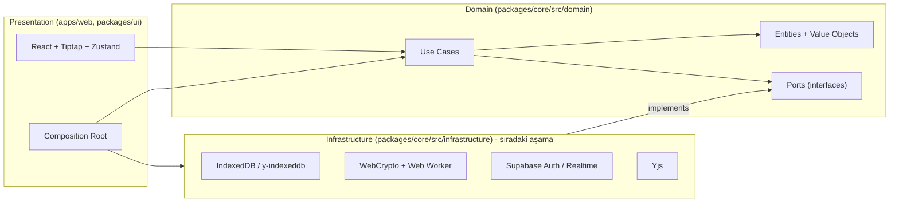
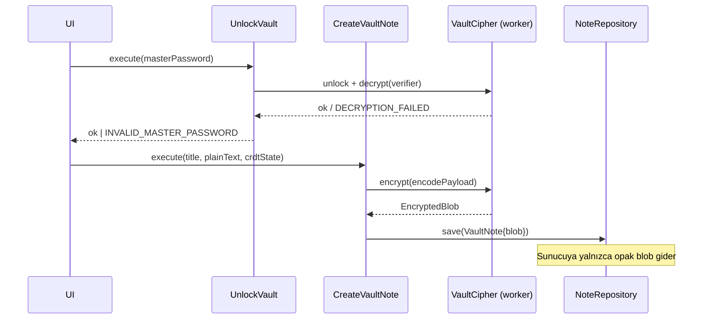

# Domain Katmanı – Clean Architecture Dokümantasyonu

> **Kapsam:** `packages/core/src/domain/` (Entity'ler, Value Object'ler, Port'lar, Use Case'ler)
> **Kaynak:** [Documantation.md](./Documantation.md) bölüm 3–9 ve 13, `.antigravityrules` bölüm 1.1
> **Durum:** Domain katmanı tamamlandı ve test edildi (32 test). Infrastructure adapter'ları ve UI entegrasyonu sonraki aşama.

---

## 1. Neden Clean Architecture?

Projenin çekirdek vaadi **E2EE Kasa + Offline-First + CRDT**. Bu kurallar (ör. "şifre sunucuya gitmez", "çevrimdışı hata değildir", "yanlış parola yerelde yakalanır") **iş kuralıdır** ve IndexedDB, Yjs, Supabase ya da React'ten bağımsız olarak doğru kalmalıdır. Domain katmanı bu kuralları tek yerde toplar; teknoloji seçimleri (Hocuspocus mu Supabase Realtime mı – Açık Soru 13.1 #5) kural değiştirmeden değişebilir.



**Bağımlılık kuralı:** oklar yalnızca içeri doğrudur. `domain/` hiçbir npm paketini, DOM/tarayıcı global'ini veya dış katmanı import edemez. Bu kural `npm run check:architecture` ile otomatik denetlenir.

---

## 2. Klasör Yapısı

```text
packages/core/src/domain/
├── shared/          result.ts · brand.ts · bytes.ts (saf base64/utf8) · text.ts (arama normalizasyonu)
├── errors/          domain-errors.ts
├── value-objects/   ids · note-title · master-password · credentials · crdt-state ·
│                    encrypted-blob · kdf-params · vault-note-payload
├── entities/        note.ts · vault.ts · user.ts
├── repositories/    note-repository.ts · vault-repository.ts          (PORT)
├── services/        vault-cipher · sync-gateway · auth-gateway · platform-services  (PORT)
├── use-cases/
│   ├── use-case.ts
│   ├── notes/       create-standard-note · update-standard-note · delete-note ·
│   │                list-notes · search-notes · load-owned-note (ortak guard)
│   ├── vault/       setup-vault · unlock-vault · lock-vault · create-vault-note ·
│   │                update-vault-note · open-vault-note · list-vault-notes · decrypt-vault-note
│   ├── sync/        synchronize-notes
│   └── auth/        sign-up-and-sign-in · sign-out · get-current-user
└── index.ts         public API  →  `import { domain } from '@pronotes/core'`
packages/core/tests/ domain testleri + in-memory fake'ler (tests/support)
```

---

## 3. Entity'ler

| Entity | Alanlar | Notlar |
|---|---|---|
| **`StandardNote`** (`kind: 'standard'`) | `id, ownerId, title, plainText, content (CrdtState), createdAt, updatedAt, deletedAt` | Sunucuda görünür not. `content` Yjs durumu; `plainText` editörden gelen **türetilmiş** alan (yerel arama + kart önizlemesi). |
| **`VaultNote`** (`kind: 'vault'`) | `id, ownerId, encryptedPayload (EncryptedBlob), createdAt, updatedAt, deletedAt` | Başlık, metin ve CRDT geçmişi **tek bir şifreli blob'un içinde**. Sunucu yalnızca opak byte ve üst veri görür (FR-5, NFR-5). |
| **`Vault`** | `ownerId, kdfParams (PBKDF2, SHA-256, iterasyon, salt), verifier (EncryptedBlob), createdAt` | Gizli bilgi içermez. Master Password ve türetilmiş anahtar **asla** buraya girmez. |
| **`User`** | `id, email` | Kimlik sağlayıcıdan (Supabase Auth) gelen asgari profil. |

`Note = StandardNote | VaultNote` ayrık birleşimdir (`kind` ayırt edici). Entity'ler **immutable**'dır; değişiklikler saf fonksiyonlarla yeni nesne döndürür: `createStandardNote`, `updateStandardNote`, `createVaultNote`, `replaceVaultPayload`, `markNoteDeleted` (soft-delete / tombstone – silme diğer cihazlara senkronize olabilsin diye).

### Value Object'ler (geçersiz durum oluşturulamaz)

| Value Object | Kural |
|---|---|
| `NoteId`, `UserId` | Branded string; boş olamaz. Yanlışlıkla birbirine atanamaz. |
| `NoteTitle` | Trim edilir, ≤ 200 karakter, boş olabilir (Keep tarzı başlıksız not). |
| `MasterPassword` | **≥ 8 karakter** (§8), trim edilmez, sunucuya/diske/loga gitmez. |
| `Email`, `AccountPassword` | E-posta biçimi; hesap şifresi ≥ 8 (Master Password'den ayrı kavram). |
| `CrdtState` | Opak `Uint8Array` (Yjs). Domain içeriğini yorumlamaz. |
| `EncryptedBlob` | `iv` = 12 bayt, `ciphertext` ≥ 16 bayt (GCM etiketi dahil). |
| `KdfParams` | PBKDF2/SHA-256, **iterasyon ≥ 100.000**, salt ≥ 16 bayt. Gizli değildir. |
| `VaultNotePayload` | `{title, plainText, crdtState}` ↔ byte dönüşümü (`encode/decodeVaultNotePayload`). |

Beklenen hatalar `Result<T, E>` ile döner; `DomainError` alt sınıfları sabit `code` taşır (`VALIDATION_ERROR`, `NOT_FOUND`, `ACCESS_DENIED`, `NOTE_KIND_MISMATCH`, `VAULT_NOT_SETUP`, `VAULT_ALREADY_SETUP`, `VAULT_LOCKED`, `INVALID_MASTER_PASSWORD`, `DECRYPTION_FAILED`, `AUTHENTICATION_FAILED`, `SYNC_FAILED`). UI `code`'a göre yerelleştirilmiş metin gösterir.

---

## 4. Port'lar (Dependency Inversion)

| Port | Sorumluluk | Infrastructure karşılığı (sonraki aşama) |
|---|---|---|
| `NoteRepository` | Yerel-öncelikli not saklama (`findById`, `findStandardByOwner`, `findVaultByOwner`, `save`) | IndexedDB (`idb` / `y-indexeddb`) |
| `VaultRepository` | Kasa yapılandırması (KDF + verifier) | IndexedDB + sunucuyla senkron |
| `VaultCipher` | `createKdfParams`, `unlock`, `lock`, `isUnlocked`, `encrypt`, `decrypt` | WebCrypto PBKDF2 + AES-256-GCM, **Web Worker** içinde; anahtar yalnızca worker belleğinde |
| `SyncGateway` | CRDT güncellemelerini arka planda it/çek (idempotent) | Hocuspocus / Supabase Realtime |
| `AuthGateway` | `signUp`, `signIn`, `signOut`, `getCurrentUser` | Supabase Auth (JWT) |
| `Clock`, `IdGenerator`, `ConnectivityMonitor` | Zaman, benzersiz id, çevrimiçi durumu | `Date`, `crypto.randomUUID`, `navigator.onLine` |

---

## 5. Use Case'ler

Her use case **tek bir kullanıcı niyeti**dir: `UseCase<Input, Output>`, port'lar constructor ile enjekte edilir, tek `execute` metodu `Promise<Result<…>>` döner.

### Notlar

| Use case | Ne yapar | Hatalar | Gereksinim |
|---|---|---|---|
| `CreateStandardNote` | Boş, sahibine ait not oluşturur ve yerel kaydeder | `VALIDATION_ERROR` | FR-1, FR-6, §9.1 |
| `UpdateStandardNote` | Başlık ve/veya gövde (CRDT + plainText) günceller | `NOT_FOUND`, `ACCESS_DENIED`, `NOTE_KIND_MISMATCH`, `VALIDATION_ERROR` | FR-3, FR-7 |
| `DeleteNote` | Standart **veya** kasa notunu soft-delete eder (kasa kilitliyken de çalışır, deşifre gerekmez) | `NOT_FOUND`, `ACCESS_DENIED` | §9.1 optimistic silme |
| `ListNotes` | Ana grid: silinmemiş standart notlar, en son düzenlenen önce | – | FR-1 |
| `SearchNotes` | Başlık + metin içinde yerel arama (büyük/küçük harf ve Türkçe aksan duyarsız: `İstanbul`↔`istanbul`, `Şirket`↔`sirket`) | – | FR-3 |

### Şifreli Kasa

| Use case | Ne yapar | Hatalar | Gereksinim |
|---|---|---|---|
| `SetupVault` | Master Password (≥ 8) doğrular, KDF parametreleri üretir, anahtarı bellekte türetir, **verifier** blob'u saklar. Kasa açık kalır | `VALIDATION_ERROR`, `VAULT_ALREADY_SETUP` | FR-4, §9.2 |
| `UnlockVault` | Anahtarı yerelde türetir, verifier'ı çözerek şifreyi **sunucuya sormadan** doğrular. Yanlışsa anahtarı siler | `VAULT_NOT_SETUP`, `INVALID_MASTER_PASSWORD` | §8 "Şifre Yanlış" |
| `LockVault` | Bellekteki anahtarı siler | – | §8 |
| `CreateVaultNote` | Başlık+metin+CRDT'yi **tek blob** olarak AES-GCM ile şifreleyip kaydeder | `VALIDATION_ERROR`, `VAULT_LOCKED` | FR-5, NFR-5 |
| `UpdateVaultNote` | Yeni IV ile yeniden şifreler | + `NOT_FOUND`, `ACCESS_DENIED`, `NOTE_KIND_MISMATCH` | FR-5 |
| `OpenVaultNote` | Tek kasa notunu düzenleme için çözer | + `DECRYPTION_FAILED` | §9.2 |
| `ListVaultNotes` | Tüm kasa notlarını **yalnızca bellekte** çözer, isteğe bağlı yerel arama; çözülemeyenleri `undecryptable` olarak bildirir | `VAULT_LOCKED` | §6.4 sunucuda arama yok |

### Senkronizasyon ve Kimlik

| Use case | Ne yapar | Hatalar |
|---|---|---|
| `SynchronizeNotes` | Çevrimiçiyse bekleyen güncellemeleri it/çek. **Çevrimdışıysa hata değil**: `{ status: 'skipped-offline' }` döner (kullanıcıya uyarı gösterilmez) | `SYNC_FAILED` |
| `SignUp`, `SignIn` | E-posta/şifre doğrular, kimlik sağlayıcıya iletir | `VALIDATION_ERROR`, `AUTHENTICATION_FAILED` |
| `SignOut` | **Önce kasayı kilitler**, sonra oturumu kapatır (anahtar oturumdan uzun yaşamaz) | – |
| `GetCurrentUser` | Kalıcı oturumu geri yükler (`null` = çıkış yapmış) | – |

**Ortak kural – `loadOwnedNote`:** not mutasyonu yapan her use case notun var olduğunu, silinmediğini ve **çağıran kullanıcıya ait** olduğunu doğrular (yetkilendirme domain'de de uygulanır; sunucu RLS'ine ek savunma).

### Örnek akış – Kasa notu yazma (§6.3-B)



---

## 6. Açık Sorulara (Bölüm 13.2) Alınan Tasarım Kararları

| # | Soru | Karar / varsayım |
|---|---|---|
| 1 | Standart notlarda hızlı arama | MVP: **istemci tarafı**; `StandardNote.plainText` türetilmiş alanı üzerinden. Sunucu FTS kararı ayrıca verilmeli. |
| 2 | Kasa için Yjs entegrasyonu | Kasa içeriği tek `EncryptedBlob`. Yjs sağlayıcısı infrastructure'da bu blob'u şifreleyip/çözen **özel bir katman** olarak yazılacak. |
| 3 | Salt / çok cihaz | Salt `Vault.kdfParams` içinde, gizli olmayan veri olarak saklanır ve senkronize edilir. |
| 4 | Parola doğrulama | `Vault.verifier`: bilinen düz metnin şifreli hali; yerelde çözülebilirse parola doğru. |
| 5 | PBKDF2 parametreleri | Domain **alt sınırı** zorlar (≥ 100.000, SHA-256). Gerçek değer infrastructure'da 1.5 sn bütçesine karşı ölçülerek belirlenmeli (OWASP daha yüksek önerir). |
| 6 | Oturum / otomatik kilit | Henüz modellenmedi; `LockVault` use case'i tetiklenebilir hazır. Süre politikası ürün kararı bekliyor. |
| 7 | Kasa yerel arama | Yalnızca bellekte (`ListVaultNotes`); düz metin indeks diske yazılmaz. |
| 8 | Garbage Collection | Kapsam dışı (infrastructure/Yjs); use case eklenmedi. |

---

## 7. Test ve Doğrulama

```bash
npm run check:architecture   # bağımlılık kuralı, saf domain, kebab-case, any yasağı
npm run type-check           # strict TS (src + testler)
npm test                     # Vitest, 32 test
```

* Testler tarayıcısız/ağsız çalışır: `packages/core/tests/support/fakes.ts` içindeki in-memory repository'ler ve AES-GCM semantiğini taklit eden `FakeVaultCipher` (yanlış anahtar → kimlik doğrulama hatası) kullanılır.
* Kapsanan kritik davranışlar: sahiplik/yetki, soft-delete, Türkçe arama, kasa kurulumu/kilit açma/yanlış parola, kasa notunun opak olması, yabancı anahtarla çözme hatası, bozuk blob raporlama, çevrimdışı sync atlama, oturum kapatınca kasanın kilitlenmesi.

---

## 8. Kapsam Dışı ve Sıradaki Adımlar

* **Infrastructure adapter'ları:** IndexedDB repository'leri, WebCrypto worker adapter'ı, Yjs + sync gateway, Supabase auth adapter'ı, composition root (`apps/web/src/composition-root.ts`).
* **Legacy kod:** `packages/core/src/{crypto,storage,crdt,sync,types}` domain'den önce yazıldı; adapter olarak `infrastructure/`'a taşınacak. Çakışmayı önlemek için domain, `@pronotes/core` içinden `domain` namespace'i ile açılır (`import { domain } from '@pronotes/core'`).
* **Bilinen teknik borç (UI):** `apps/web` mevcut kodu bu kurallara henüz uymuyor (PascalCase dosya adları, `any` kullanımı, `index.css`, store içinden doğrudan Supabase/worker çağrısı). Use case'lere geçiş sırasında düzeltilecek.
* **Henüz modellenmeyenler (v1.1+):** salt okunur link paylaşımı, etiket/renk, karanlık mod, GC politikası, otomatik kilit süresi.
